     
    <h2>Hey, I'm Neo</h2>

 
 

Most of my stuff is privated because its either a project like Lunar where i actively work on or just some random stuff i tried doing and where i am embarrassed about :P 
 

Maybe im going to make that stuff public at some point but who knows

 

<h2 align="center">╰┈➤ about me</h2>

-  lunar - geoguessr script
- 
- 20 years old
- based in germany

<h2 align="center">╰┈➤ Discord Status</h2>

<!-- cool-readme:start -->

<picture>
  <source media="(prefers-color-scheme: dark)" srcset="stats/summary-dark.svg">
  
</picture>
<picture>
  <source media="(prefers-color-scheme: dark)" srcset="stats/languages-dark.svg">
  
</picture>

<!-- cool-readme:end -->

