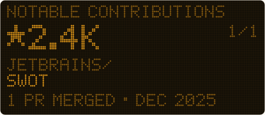

     
    <h2>Hey, I'm Neo</h2>

 
 

Most of my stuff is privated because its either a project like Lunar where i actively work on or just some random stuff i tried doing and where i am embarrassed about :P 
 

Maybe im going to make that stuff public at some point but who knows

 

<h2 align="center">╰┈➤ about me</h2>

-  lunar - geoguessr script
- 
- 20 years old
- based in germany

<h2 align="center">╰┈➤ Discord Status</h2>

<h2 align="center">╰┈➤ My tech <3 </h2>

  <table align="center">
    <tr>
      <td align="center" width="96">
        
         React
      </td>
      <td align="center" width="96">
        
         JavaScript
      </td>
      <td align="center" width="96">
        
         TypeScript
      </td>
      <td align="center" width="96">
        
         Python
      </td>
      <td align="center" width="96">
        
         Java
      </td>
      <td align="center" width="96">
        
         .NET
      </td>
      <td align="center" width="96">
        
         C Sharp
      </td>
      <td align="center" width="96">
        
         Supabase
      </td>
      <td align="center" width="96">
        
         MySQL
      </td>
    </tr>
    <tr align="center">
      <td align="center" width="96">
        
         Github
      </td>
      <td align="center" width="96">
        
         Git
      </td>
      <td align="center" width="96">
        
         HTML5
      </td>
      <td align="center" width="96">
        
         CSS
      </td>
      <td align="center" width="96">
        
         Tailwind
      </td>
      <td align="center" width="96">
        
         Electron.js
      </td>
    </tr>
    <tr>
      <td align="center" width="96">
        
         Node.js
      </td>
      <td align="center" width="96">
        
         Next.js
      </td>
      <td align="center" width="96">
        
         VSCode
      </td>
    </tr>
  </table>

<!-- cool-readme:start -->

<picture>
  <source media="(prefers-color-scheme: dark)" srcset="stats/summary-dark.svg">
  
</picture>
<picture>
  <source media="(prefers-color-scheme: dark)" srcset="stats/languages-dark.svg">
  
</picture>

<picture>
  <source media="(prefers-color-scheme: dark)" srcset="stats/contributions-dark.svg">
  
</picture>
<picture>
  <source media="(prefers-color-scheme: dark)" srcset="stats/weekly-dark.svg">
  
</picture>

<!-- cool-readme:end -->
